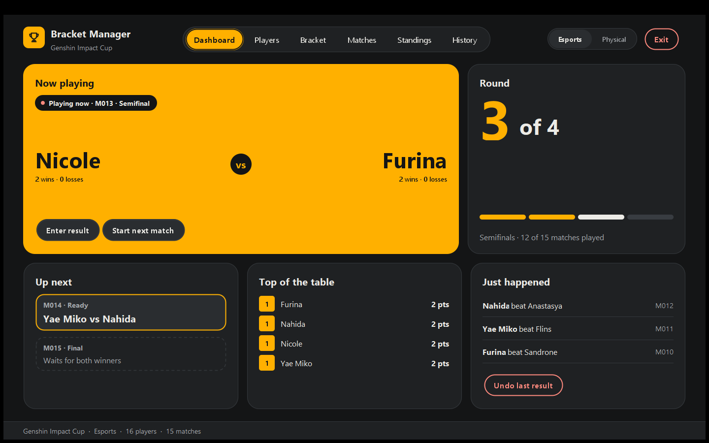
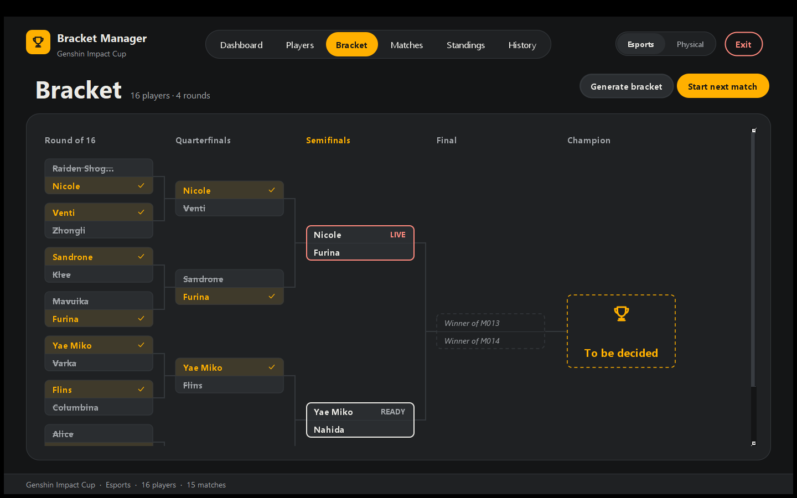
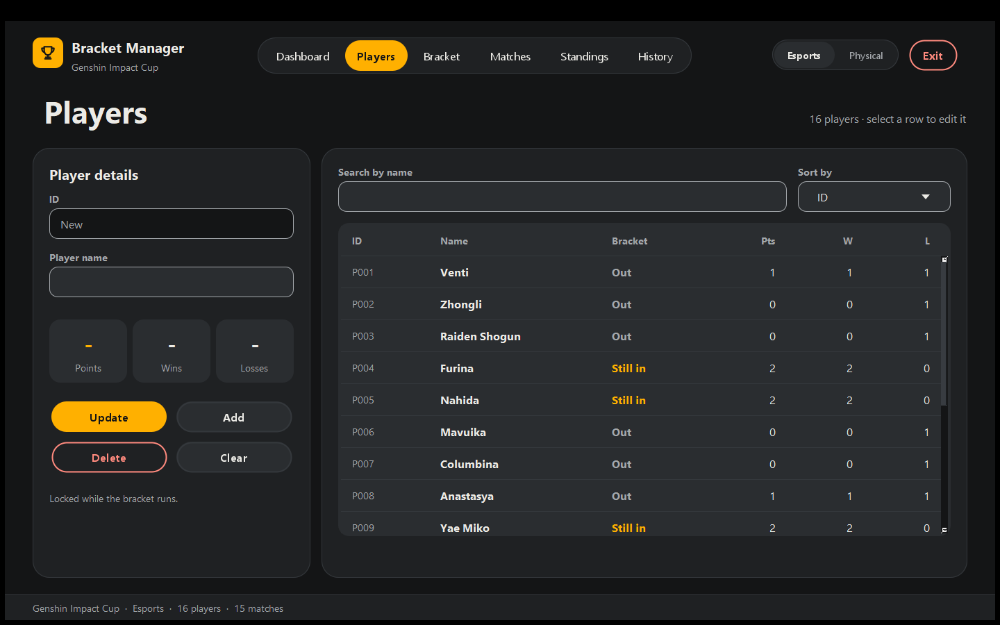
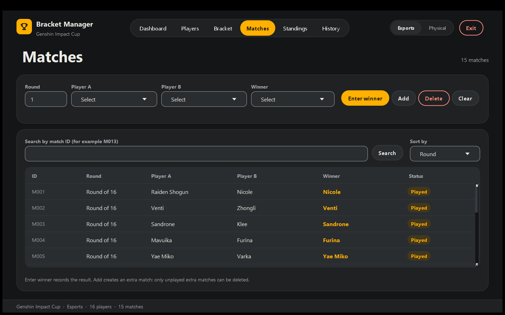
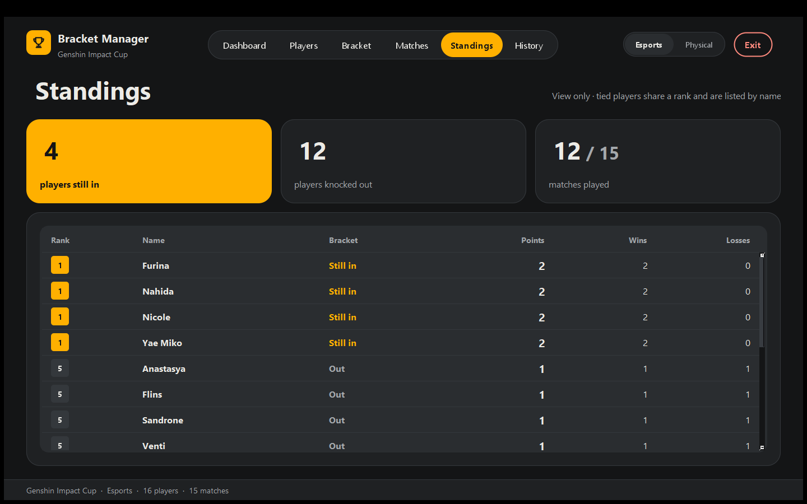
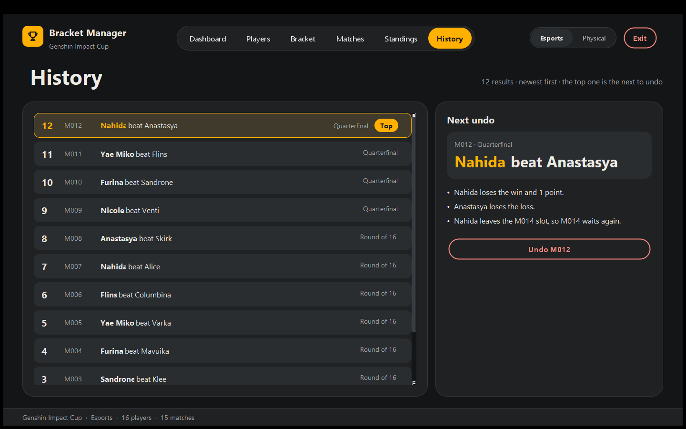
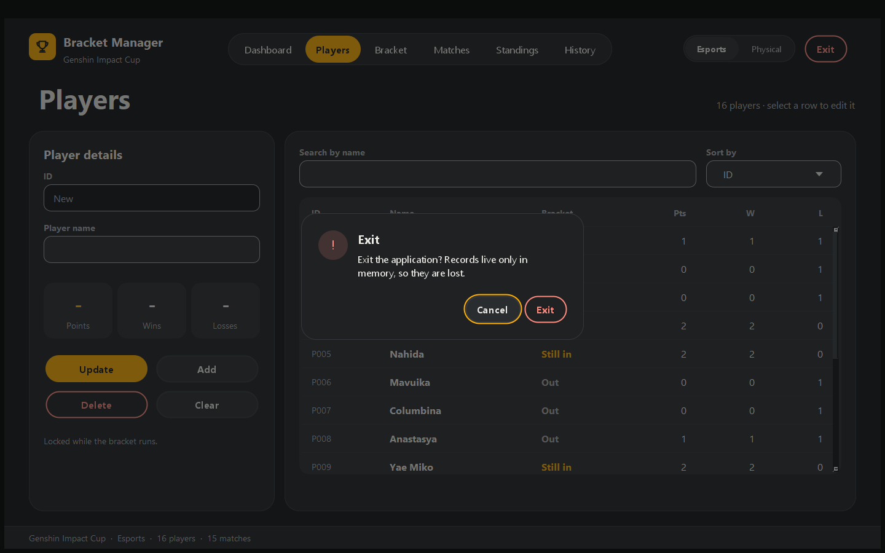

# Tournament Bracket Manager

A single-elimination tournament desktop app for 4, 8 or 16 players or teams. Written in Java with a Swing interface. All records live in Java collections in memory, with no database.

CC 104 final project, by Lance Kyle Ebue.



## What it does

- **Login** with a sport mode choice (Esports or Physical Sports, which only changes the labels).
- **Dashboard** with the match being played, the round, the next matches, the top of the table and the latest results.
- **Players**: add, update, delete, clear, search by name and sort. The list locks once the bracket exists.
- **Bracket**: generate a shuffled bracket for 4, 8 or 16 players, start the next match, and watch winners move on. The champion has a slot at the right edge.
- **Matches**: enter a winner, add extra matches, search by match ID and sort by round or ID.
- **Standings**: ranked by points, with tied players sharing a rank.
- **History and Undo**: every result, newest first, and Undo for the latest one with a preview of what it changes.
- Success and error notifications, and a confirmation before anything is deleted or lost.

## Run it

You need a JDK. It was built and tested with JDK 25.

Download `TournamentBracketManager.jar` from the Releases page, then:

```powershell
java -jar TournamentBracketManager.jar
```

Sign in with the demo account: username `organizer`, password `1234`.

## Build from source

From the project folder:

```powershell
javac -d out (Get-ChildItem -Recurse src -Filter *.java).FullName
java -cp out ui.Main
```

On macOS or Linux:

```bash
javac -d out $(find src -name '*.java')
java -cp out ui.Main
```

To package the JAR:

```powershell
jar --create --file TournamentBracketManager.jar --main-class ui.Main -C out .
```

The `.vscode` folder has matching build, run and test tasks.

## Tests

64 checks run without opening a window: the recursive round count, searches, sorts, brackets of 4, 8 and 16, a full 16-player tournament, Undo, round names and rejected inputs.

```powershell
java -cp out test.TournamentTest
```

## Data structures and algorithms

The brief's required concepts, all written by hand (no `Collections.sort`):

| Concept | Where | Used for |
|---|---|---|
| ArrayList | `ds/PlayerStore` | the players |
| LinkedList | `ds/MatchStore` | the matches in bracket order |
| Stack | `ds/ResultStack` | results, so Undo pops the newest |
| Queue | `ds/ReadyQueue` | matches ready to play, first in first out |
| Linear search | `algo/Searches` | find a player by name |
| Binary search | `algo/Searches` | find a match by ID on an ID-sorted copy |
| Selection sort | `algo/Sorts` | players by points |
| Insertion sort | `algo/Sorts` | ties by name |
| Merge sort | `algo/Sorts` | matches by round |
| Recursion | `algo/Rounds` | `rounds(n) = 0 if n <= 1, else 1 + rounds(n / 2)` |
| Fisher-Yates shuffle | `algo/Shuffle` | seeding round one |

## Project layout

```
src/
  model/   Tournament (the rules), Player, Match, SportMode
  ds/      the four collection wrappers
  algo/    searches, sorts, rounds, shuffle, ranks
  ui/      Swing screens and shared widgets, all styled from Theme
  test/    TournamentTest
docs/      project documentation (PDF, DOCX), slides, screenshots
UI_GUIDE.md   the design rules and a changelog
```

The screens hold no tournament rules. They call `Tournament` and redraw from it.

## Design

Dark grey tiles with one amber accent, Bricolage Grotesque for titles and DM Sans for text. Every colour, font size and animation length comes from `ui/Theme.java`. Text meets WCAG AA contrast, every control can be reached with the keyboard, and animations can be turned off with `-Dtbm.reduceMotion=true`. The full rules are in [UI_GUIDE.md](UI_GUIDE.md).

| | |
|---|---|
|  |  |
|  |  |
|  |  |

## Limits

- Data is lost when the app closes. Saving to a file would be the first improvement.
- The login is one fixed demo account, not stored accounts.
- No screen reader testing yet.
